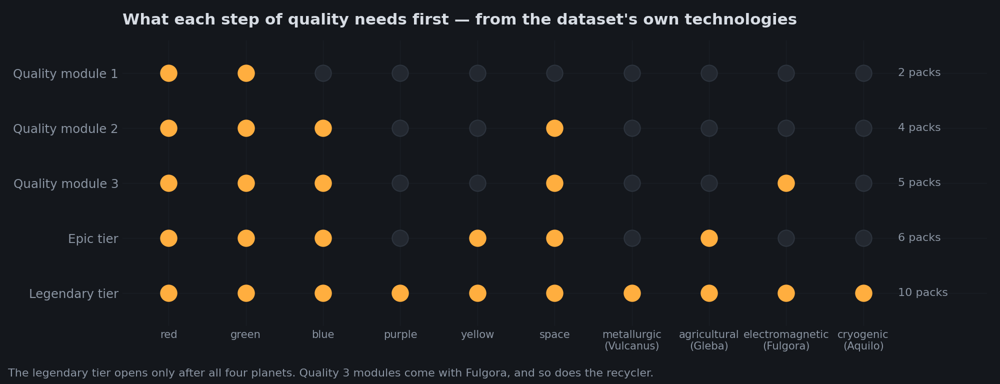
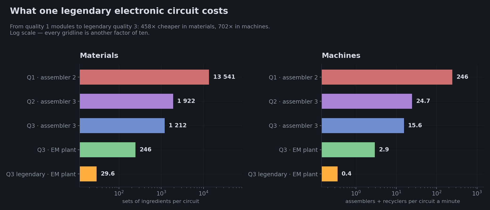
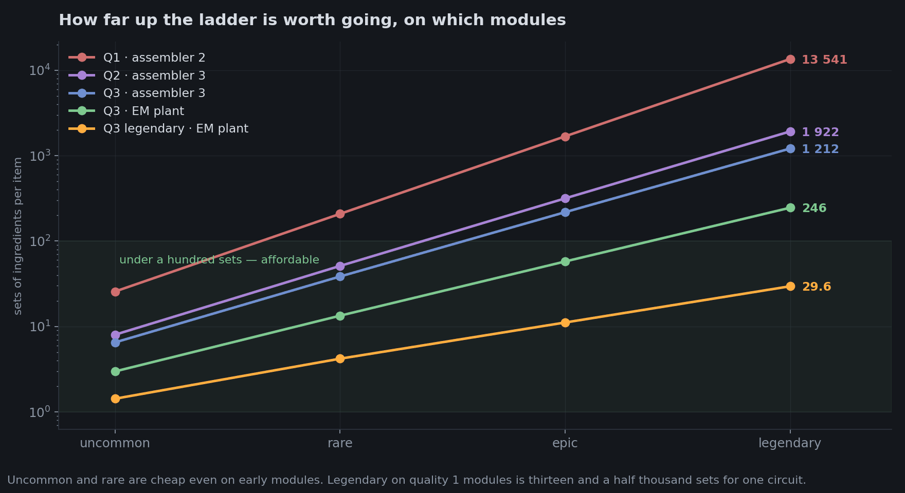
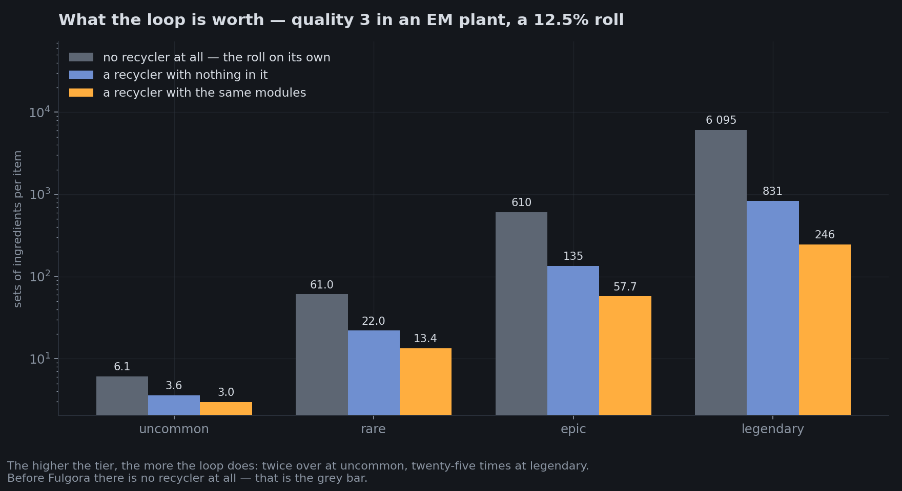
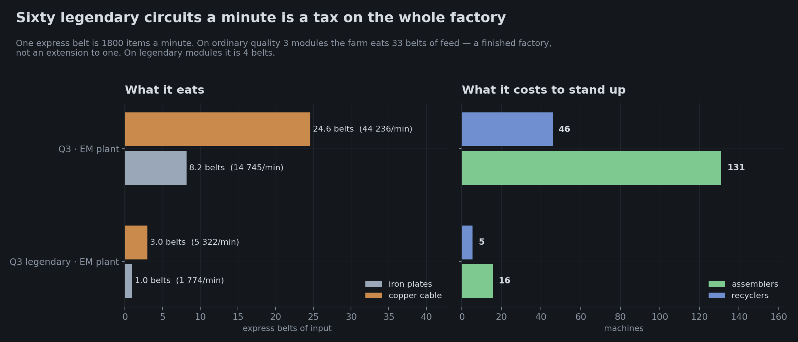
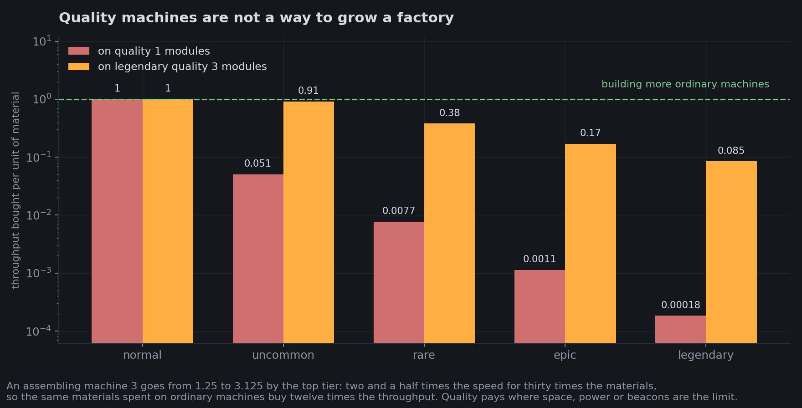
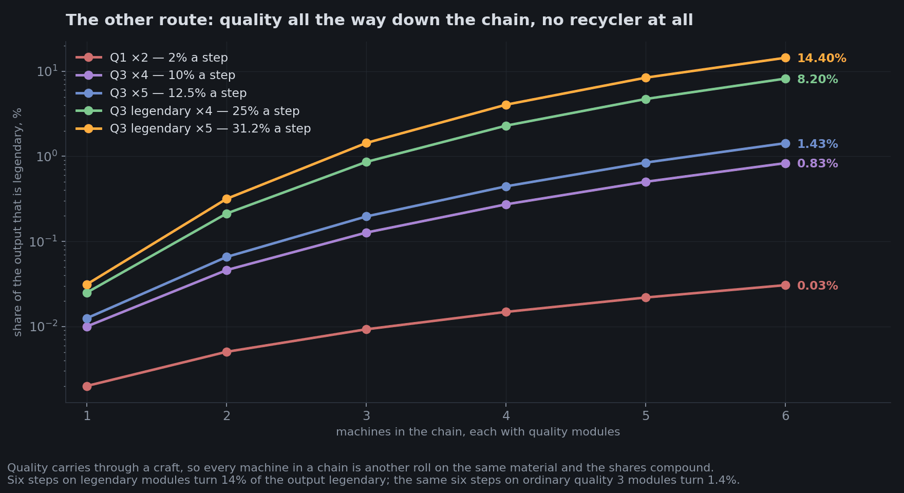
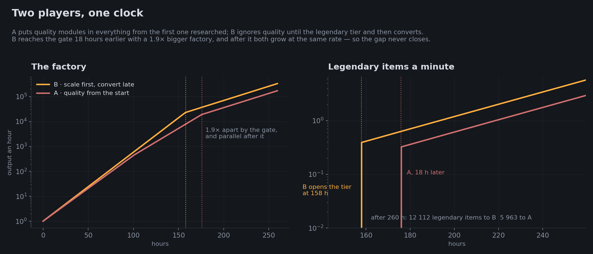

# When to go for quality

Not a description of the software: an answer the calculator gave, kept because the question
comes up in every Space Age run and because the figures re-derive themselves from the data.

**Should you invest in quality from the start, or scale the factory first and make one hard
push later with quality 3 modules?** Everything below is the recycling tab's arithmetic on
electronic circuits — cheap, universal, and the thing most people farm first.

## The short answer

**Scale first, and make the quality push once, after Fulgora.** Take the free quality early —
quality modules in miners and furnaces cost nothing to run and hand you better machines as a
by-product — but do not build a *farm* before you can build it properly. Three reasons, in the
order they bite.

## There is nothing to build before Fulgora



Straight out of the dataset's technology recipes. Quality 1 modules are red and green science —
early. Quality 3 modules need electromagnetic science, which is Fulgora. The **legendary tier
needs all ten science packs**, which is every planet, including cryogenic from Aquilo.

The recycler arrives with Fulgora as well. That part is from the game rather than from this
dataset — it carries no link from a recipe to the technology that unlocks it — but it settles
the question: before Fulgora there is no loop at all, only the roll, and the roll is the part
that does not work.

## Every module tier is worth an order of magnitude



The same ladder, five ways of standing it up. One legendary circuit costs **13 541 sets of
ingredients** on quality 1 modules in an assembling machine 2, and **29.6** on legendary
quality 3 modules in an electromagnetic plant. That is 458× in materials and 702× in machines,
for waiting.

Worth reading the middle of that chart too: quality 3 modules in an assembling machine 3 cost
1 212 sets, and the *same modules* in an electromagnetic plant cost 246. Five times better, and
only part of it is the fifth module slot — the rest is the plant's own +50% productivity, which
applies again every time the material goes round the loop.



Which tier you are after changes the answer completely. Uncommon and rare are affordable on
anything: 26 sets an item on quality 1 modules, 51 for rare on quality 2. Those are worth
having early, for personal kit — armour, drills, a better reactor. Epic and legendary on early
modules are not a project, they are a refusal.

## The loop is most of the mechanic



The roll on its own is a rounding error; nearly every legendary comes back up the ladder rather
than falling out of a machine. Without a recycler a legendary circuit costs 6 095 sets; with one
holding the same modules, 246. **Twenty-five times**, and the multiple grows with the tier — at
uncommon the loop only saves half.

This is the same fact as the first section from the other side: quality without a recycler is
not a cheaper version of quality farming, it is a different and much worse thing — *for one
recipe*. A long chain is a different story, and the next section but one is about it.

## A farm is a tax on the whole factory



Sixty legendary circuits a minute — a modest goal — eats **33 express belts of feed** and 177
machines on ordinary quality 3 modules. On legendary modules the same output is 4 belts and 21
machines.

That is the real argument for scaling first. A quality farm does not add production, it
*converts* it: it takes a finished factory's throughput and returns a trickle. Building one
before the factory exists means building it with nothing to feed it.

## Is the early curve slow, or is it flat?

The natural way to picture the two strategies is a slow climb against a sharp one: pay for
quality from the start and legendary output creeps up; scale and research instead and it takes
off later. The shape is right. The mechanism is not, and the real one is worse for going early.

**Before the tech, the early curve is not slow — it is exactly zero.** The legendary tier needs
all ten science packs. Whatever you spend on quality before that lands in uncommon and rare,
and not one legendary item exists on either strategy until the same moment. Two curves that
are both zero are not a race; what is being decided in that period is only how big the factory
is when the race starts.

And on that, early quality is a poor investment on its own terms:



A quality machine is faster — an assembling machine 3 goes 1.25 → 3.125 across the tiers — but
the ladder charges 26× the materials for an uncommon one on quality 1 modules, and the same
materials buy 26 ordinary machines. One step of quality on the best modules in the game is
roughly break-even (0.91); everything past that loses. A legendary machine buys a **twelfth**
of the throughput those materials would buy as ordinary machines, and an uncommon one on
quality 1 modules a **twentieth** — chasing legendary machines that early is off by a factor of
five thousand. Quality pays when the constraint is *not* materials: space on a platform, power,
beacon effectivity, or an item that has to be legendary to do its job.

So the honest version of the shape is not a slow curve against a steep one. It is **a step**:
zero on both strategies, then, at the gate, the same factory converts and starts producing at
one legendary per 29.6 sets. Whoever arrives at the gate with the bigger factory wins, and
diverting throughput into quality before it compounds against you the whole way there.

## Mining quality ore is the exception worth knowing

There is a second way to make a legendary and it is the one the "quality ore" idea is reaching
for: no recycler anywhere, just quality modules in *every* machine of the chain. Quality carries
through a craft, so each machine is another roll on the same material, and the shares compound
with the length of the chain.



Six machines deep on legendary quality 3 modules, **14% of what comes out is legendary** — with
no loop at all. That is a real strategy and this document's first three sections do not describe
it.

But look at what separates the lines: the same six steps on *ordinary* quality 3 modules give
1.4%, and on quality 1 modules 0.03%. Seventeen-fold and five-hundred-fold — the same threshold
as everywhere else. The chain does not change when to start; it changes what to build once the
modules are legendary, and it is why quality modules in the drills are the last step of a
quality build-out rather than the first.

## Two players, one clock

The argument so far is about ratios. Here it is as a race, which is the form the question
usually gets asked in.

**Player A** takes quality seriously from the first quality module researched: modules in the
chain, modules in the drills, upgraded as the tech allows. **Player B** ignores quality
completely, builds and researches, and converts only once the legendary tier is open.



Everything about quality in that simulation is read from the data — what a module gives, what a
machine's slots are, what a ladder yields. Everything about *time* is a dial, because the
dataset has no research costs and no build rates: a factory grows by reinvesting what it makes,
research is a fixed share of output, and the gates are fractions of the way to legendary. The
run above puts B at the legendary tier at **158 hours** and A **18 hours
later**, with a **1.9× bigger factory**, and after 260 hours it is
12,112 legendary items to B against 5,963.

Three things in that picture are worth more than the numbers on it:

- **The penalty is paid before the gate and then frozen.** After it, both run the same
  technology and the same allocation, so the curves are parallel: A never catches up and never
  falls further behind. What A lost is exactly what it diverted while the diversion could not
  produce a single legendary item.
- **A is late to its own gate.** Quality spending is science spending forgone, so the player
  chasing quality reaches the tier that makes quality worth chasing last.
- **The takeoff is the modules feeding themselves.** Neither curve steps straight to full rate:
  a fresh farm runs on ordinary quality 3 modules at 246 sets an item and pays its first output
  into legendary modules, which take it to 29.6. That self-improving stretch is the sharp rise —
  it is not scale, it is the loop upgrading its own tools.

The model is unfair to A in one way and generous in another. Unfair: A is given no credit for
the uncommon machines it banks along the way. Generous: at 26× the materials for +30% speed,
those machines return about **1% of what the diversion cost**, so crediting them properly would
move A's line by less than the width of it.

And the ordering does not depend on the dials. A sweep over how much A diverts, how fast a
factory grows and how much of it runs quality modules — 27 settings — puts A ahead in **none of
them**. It cannot: every unit A spends before the gate produces zero legendary items and delays
the research that opens it. For A to win, early quality would have to make the factory grow
faster, and the chart above it says it does the opposite.

## What that adds up to

1. **Before Fulgora** — quality modules in miners and furnaces, and keep whatever uncommon and
   rare machines fall out. It is free and it compounds. Do not build a farm; there is no
   recycler to build it with.
2. **Space science → quality 2 modules.** Rare is 51 sets an item, which is fine for equipment
   and nowhere near fine for production.
3. **Fulgora: quality 3 modules and the recycler.** This is where a farm becomes worth the
   floor space — and the first thing to farm is the quality modules themselves. Going from
   ordinary to legendary quality 3 modules makes everything afterwards 8.3× cheaper (246 → 29.6
   sets), so it pays for itself before anything else does.
4. **Then push it down the chain.** Once the modules are legendary, quality modules in the
   drills and in every intermediate step are worth more than a bigger loop: six steps deep is
   14% legendary against 0.03% at the top of the chain alone.
5. **The legendary tier itself waits for Aquilo**, so the push happens once and late by
   construction. That is the whole case against paying for it early.

## Where the numbers come from

```bash
npm run charts    # solves the ladders, then draws them
```

`scripts/quality-charts.mjs` runs `planQuality` for every setup and tier and writes
`docs/images/quality-strategy.json`; `scripts/quality-charts.py` draws it. Nothing on the charts
is typed in by hand, and the unlock table is read from the dataset's technology recipes. The
drawing step needs matplotlib and pillow — the only Python in this repository, and only for
this.

What the model does not include, all of which is in [recycling.md](recycling.md):

- **No beacons.** Real farms ring the assemblers with speed modules. That changes how many
  machines a rate needs; it does not change the material ratios, which is what these charts are
  about.
- **One recipe and one recycler per ladder.** The two-recipe loop — cast from endless molten
  iron, shred, feed the plates to the assembling recipe — is a real strategy and is not here.
- **Copper cable is counted as a belt of input**, though in practice it is made on the spot from
  plates. The belt figure for it is an upper bound; the plate demand behind it is not.
- **Ingredients arrive at one quality**, the base tier, and the ladder is the same setup on
  every rung. Per-rung machines are supported by the tab and were not varied here. The chain
  figure is the exception: it is `spread` applied step after step, which is the same arithmetic
  the tab uses, but it is not a plan the tab can draw.
- **No clock.** Research costs and build times are not in this dataset — a technology recipe
  carries its science packs but not how many units of research it takes — so nothing here has a
  real time axis. Everywhere except the race, materials stand in for time, which holds at a
  fixed factory size and nowhere else.
- **The race is a model, and its dials are in `scripts/quality-race.mjs`**: the growth rate, the
  science share, the research to reach legendary, and how much each player diverts. They set
  where the gate falls and how big the gap is; they do not set which player is ahead, and the
  sweep in the same file is the check on that.
